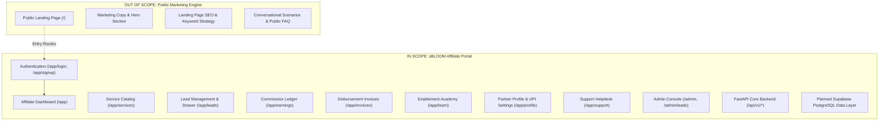
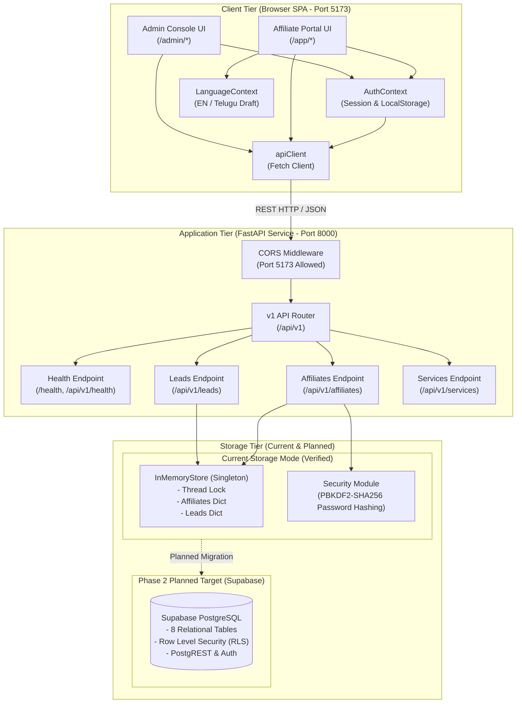

# sBLOOM Affiliate Portal — System Design Document
**Document ID:** `SBD-ARCH-01`  
**Target System:** sBLOOM Affiliate Portal (Authenticated Application)  
**Audit & Architecture Date:** November 3, 2026  
**Status:** IMPLEMENTED AND VERIFIED (Foundation & Integration Phase)  
**Security Level:** Internal Engineering Reference  

---

## 1. Executive Summary & Audit Context

The **sBLOOM Affiliate Portal** is a dedicated enterprise web application designed for regional creators, agency founders, business development consultants, and digital aggregators across South India and pan-India. The platform enables partners to obtain tracked referral attribution, submit and monitor qualified B2B client leads, inspect lead lifecycle progression, and audit commission settlements for high-ticket digital growth services.

This technical design document is a repository-grounded audit of the **authenticated affiliate application only**. The public marketing landing page at `/` is strictly excluded from detailed analysis except as the navigation ingress point into the portal's authentication routes (`/app/signup` and `/app/login`).

### Ground Truth Architectural Finding
Based on the repository audit, the system currently operates in a **hybrid two-tier architecture**:
1. **Frontend Service (`/frontend`)**: A client-side Single-Page Application (SPA) built with React 19, TypeScript, Vite, React Router DOM 7, and Tailwind CSS.
2. **Backend Service (`/backend`)**: A REST API service built with Python 3.13, FastAPI, Uvicorn, and Pydantic v2.
3. **Data Layer**: The backend currently operates in **temporary thread-safe in-memory storage** (`STORAGE_MODE="in_memory_temporary"` with `DATABASE_CONNECTED=False`). Persistent database integration with **Supabase (PostgreSQL with Row Level Security)** is explicitly designed, structured, and **PLANNED** for Phase 2 migration, as confirmed across `.env.example`, `backend/app/main.py`, and `FRONTEND_DESIGN_SPEC.md`.

---

## 2. Strict Scope Boundaries

---

## 3. High-Level System Architecture

---

## 4. Technology Stack Inventory

| Component / Layer | Technology | Version | Purpose in Portal | Verification Status |
| :--- | :--- | :--- | :--- | :--- |
| **Frontend Framework** | React | `^19.3.1` | Component lifecycle, concurrent rendering, virtual DOM | **IMPLEMENTED AND VERIFIED** |
| **Frontend Language** | TypeScript | `~7.0.2` | Static typing, interface contracts, strict compile checks | **IMPLEMENTED AND VERIFIED** |
| **Build Tool & Bundler** | Vite | `^8.3.5` | Fast HMR dev server, optimized rollup bundling | **IMPLEMENTED AND VERIFIED** |
| **Client Routing** | React Router DOM | `^7.18.5` | Client-side nested route trees, layout wrapping, guards | **IMPLEMENTED AND VERIFIED** |
| **CSS Utility Framework**| Tailwind CSS | `^3.4.19` | Custom design token utilities, responsive grids | **IMPLEMENTED AND VERIFIED** |
| **CSS Compilation** | PostCSS + Autoprefixer | `^8.5.32` | Vendor prefixing, CSS variable processing | **IMPLEMENTED AND VERIFIED** |
| **Iconography** | Lucide React | `^1.66.0` | SVG icons for dashboard, sidebar, and status pills | **IMPLEMENTED AND VERIFIED** |
| **Static Code Linter** | Oxlint | `^1.89.0` | Fast Rust-based ESLint rule verification | **IMPLEMENTED AND VERIFIED** |
| **Backend Runtime** | Python | `3.13.x` | Asynchronous execution environment | **IMPLEMENTED AND VERIFIED** |
| **Backend Framework** | FastAPI | `0.115.0+` | ASGI web framework, OpenAPI docs, typed dependency injection | **IMPLEMENTED AND VERIFIED** |
| **ASGI Server** | Uvicorn | `0.32.0+` | High-performance asynchronous HTTP server | **IMPLEMENTED AND VERIFIED** |
| **Validation Layer** | Pydantic v2 / Settings | `2.9.0+` | Typed schema serialization, validation, env configuration | **IMPLEMENTED AND VERIFIED** |
| **Test Runners** | Unittest / Pytest | Standard | Backend endpoint validation and schema testing | **IMPLEMENTED AND VERIFIED** |
| **Current Data Store** | In-Memory Dictionary | Native Python | Volatile thread-safe store for demo and foundation testing | **IMPLEMENTED AND VERIFIED** |
| **Planned Data Store** | Supabase (PostgreSQL) | v15+ (Planned) | Multi-tenant persistent relational database with RLS | **PLANNED** |

---

## 5. Architectural Design Principles

1. **Strict Separation of Concerns**:
   - The frontend (`/frontend`) is a fully standalone client that can be deployed to static hosting (Vercel, Netlify, Cloudflare Pages).
   - The backend (`/backend`) is an independent FastAPI service exposing versioned REST endpoints (`/api/v1/`).
   - Communication occurs strictly over standard HTTP/JSON with CORS enforcement.

2. **Honest Empty States & Zero Data Fabrication**:
   - Unlike legacy prototype systems that populated fake mock data, the portal implements honest zero-data handling.
   - When no genuine leads, commissions, or invoices exist, screens render informative empty states ([`sampleEarnings.ts`](file:///e:/HARSHITHA/OTTOBON/Affiliate/frontend/src/data/sampleEarnings.ts), [`sampleLeads.ts`](file:///e:/HARSHITHA/OTTOBON/Affiliate/frontend/src/data/sampleLeads.ts)).

3. **Bilingual South Indian Regional Support**:
   - The UI includes native English and Telugu script support ([`LanguageContext.tsx`](file:///e:/HARSHITHA/OTTOBON/Affiliate/frontend/src/context/LanguageContext.tsx)).
   - A global notice indicates draft review status when Telugu is activated, using the `Noto Sans Telugu` font stack.

4. **Security-First Password Handling**:
   - Even in demo in-memory storage, affiliate passwords submitted via registration are never stored in plain text.
   - Credentials are cryptographically salted and hashed using **PBKDF2-HMAC-SHA256** with 100,000 iterations ([`security.py`](file:///e:/HARSHITHA/OTTOBON/Affiliate/backend/app/core/security.py)).

5. **Client-Side Authorization Route Guarding**:
   - Unauthenticated visitors attempting to navigate directly to `/app/*` routes are intercepted by [`AffiliateLayout.tsx`](file:///e:/HARSHITHA/OTTOBON/Affiliate/frontend/src/components/layout/AffiliateLayout.tsx) and redirected to `/app/login` with preserved origin paths.

---

## 6. Known System Limitations & Phase 2 Transition Road Map

| Area | Current State (Phase 1) | Planned State (Phase 2) | Impact / Mitigation |
| :--- | :--- | :--- | :--- |
| **Persistence** | Volatile in-memory store (`storage.py`). Resets when Uvicorn restarts. | Persistent PostgreSQL on Supabase with foreign-key constraints. | Acceptable for foundation verification; database migration required before production launch. |
| **Session Security** | Browser `localStorage` holds user session object; backend has no JWT issuance. | Supabase GoTrue Auth with HTTP-only cookies and signed JWT tokens. | Role tampering currently possible via client storage manipulation; backend validation required in Phase 2. |
| **Commission Ledger** | Hardcoded UI presentation records in `EarningsPage.tsx`. | Derived from `commissions` table populated upon lead status transitions. | Financial figures currently serve as UI template placeholders. |
| **Admin Authorization** | Simulated client-side role toggle (`toggleRole()`) in `AuthContext.tsx`. | Supabase `app_metadata.role` or dedicated `admin_users` table checked via RLS. | Admin console currently for preview/demonstration purposes only. |
| **Audit Trails** | No persistent history of status transitions or affiliate profile changes. | `lead_status_history` and `audit_logs` tables populated via PostgreSQL triggers. | Full regulatory compliance planned for Phase 2. |

