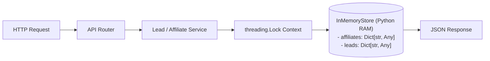

# sBLOOM Affiliate Portal — Backend & API Design
**Document ID:** `SBD-ARCH-03`  
**Target System:** sBLOOM Affiliate Portal Backend API (`/backend`)  
**Audit & Architecture Date:** November 3, 2026  
**Status:** IMPLEMENTED AND VERIFIED  
**Security Level:** Internal Engineering Reference  

---

## 1. Executive Summary & Technology Stack

The **sBLOOM Affiliate Portal Backend** is a high-performance RESTful API service built with **Python 3.13**, **FastAPI**, **Uvicorn**, and **Pydantic v2**. It powers partner registration, referral code attribution, enterprise lead capture, commission calculation, and catalog querying for the affiliate portal.

### Technology Stack Specifications
| Component | Technology | Version | Purpose |
| :--- | :--- | :--- | :--- |
| **Runtime** | Python | `3.13.x` | Core application execution environment |
| **Web Framework** | FastAPI | `^0.115.0` | High-performance ASGI framework with automatic OpenAPI docs |
| **ASGI Server** | Uvicorn | `^0.32.0` | Production-grade ASGI server running on port `8000` |
| **Validation & Serialization** | Pydantic v2 | `^2.9.2` | Strict schema validation, type enforcement, and field validators |
| **Data Layer (Current)** | `InMemoryStore` | Internal Singleton | Thread-locked RAM storage (`STORAGE_MODE="in_memory_temporary"`) |
| **Data Layer (Planned)** | Supabase / PostgreSQL | Phase 2 | Relational storage with Row Level Security (RLS) |
| **Security Utilities** | `hashlib` + `secrets` | Standard Library | Salted PBKDF2-HMAC-SHA256 password hashing |
| **Testing Harness** | `pytest` + `httpx` | `^8.3.0` | Comprehensive unit and integration test suite |

---

## 2. Complete REST API Endpoint Inventory

The backend organizes all operational endpoints under the `/api/v1` prefix (with health probes also aliased at root `/health`).

| HTTP Method | Route Path | Handler Function | Request Schema | Response Schema | Auth / Headers | HTTP Status | Description |
| :--- | :--- | :--- | :--- | :--- | :--- | :--- | :--- |
| `GET` | `/health` | `get_health()` | None | `HealthResponse` | None | `200 OK` | Root health probe and diagnostic status |
| `GET` | `/api/v1/health` | `get_health()` | None | `HealthResponse` | None | `200 OK` | Namespaced health probe with uptime and latency |
| `POST` | `/api/v1/affiliates/register-demo` | `register_affiliate()` | `AffiliateRegisterRequest` | `AffiliateResponse` | None | `201 Created` | Instant partner self-registration and code generation |
| `GET` | `/api/v1/affiliates/me` | `get_my_profile()` | None | `AffiliateResponse` | `X-Affiliate-Id` (Optional) | `200 OK` | Retrieves active affiliate partner profile |
| `PATCH`| `/api/v1/affiliates/me` | `update_my_profile()`| `AffiliateUpdateRequest` | `AffiliateResponse` | `X-Affiliate-Id` (Optional) | `200 OK` | Updates payout UPI or notification preferences |
| `POST` | `/api/v1/leads` | `submit_lead()` | `LeadCreateRequest` | `LeadResponse` | None | `201 Created` | Submits client referral lead with attribution |
| `GET` | `/api/v1/leads` | `list_leads()` | Query Parameters | `LeadListResponse` | None | `200 OK` | Filtered, paginated list of referral leads |
| `GET` | `/api/v1/leads/{lead_id}` | `get_lead()` | Path Parameter | `LeadResponse` | None | `200 OK` | Fetches single lead record by unique ID |
| `GET` | `/api/v1/services` | `list_services()` | None | `ServiceListResponse` | None | `200 OK` | Full catalog of promotional services |
| `GET` | `/api/v1/services/clients` | `list_clients()` | None | `ClientListResponse` | None | `200 OK` | Verified client references and case proofs |

---

## 3. Pydantic Schemas & Data Validation Architecture

All input schemas utilize Pydantic v2 with strict constraints, field validators, and descriptive OpenAPI metadata.

### 3.1 Affiliate Schemas (`backend/app/schemas/affiliate.py`)

#### `AffiliateRegisterRequest`
```python
class AffiliateRegisterRequest(BaseModel):
    name: str = Field(..., min_length=2, max_length=100)
    email: EmailStr = Field(...)
    phone: str = Field(..., min_length=8, max_length=20)
    password: str = Field(..., min_length=6, max_length=100)
    category: str = Field("Tech & Digital Creators")
    payout_upi: Optional[str] = Field(None, max_length=100)
    consent: bool = Field(...)

    @field_validator("consent")
    def validate_consent(cls, v: bool) -> bool:
        if not v:
            raise ValueError("You must agree to the partner terms and ethics guidelines to register.")
        return v
```

#### `AffiliateResponse`
```python
class AffiliateResponse(BaseModel):
    id: str
    name: str
    email: EmailStr
    phone: str
    referral_code: str
    category: str
    payout_upi: Optional[str] = None
    joined_at: str
    role: str = "affiliate"
    notification_whatsapp: bool = True
    notification_email: bool = True
    disclaimer: str
```

### 3.2 Lead Schemas (`backend/app/schemas/lead.py`)

#### `LeadCreateRequest`
```python
class LeadCreateRequest(BaseModel):
    business_name: str = Field(..., min_length=2, max_length=150)
    contact_name: str = Field(..., min_length=2, max_length=100)
    email: EmailStr = Field(...)
    phone: str = Field(..., min_length=8, max_length=25)
    location: str = Field(..., min_length=2, max_length=100)
    sector: str = Field(..., min_length=2, max_length=100)
    services_of_interest: List[str] = Field(..., min_items=1)
    business_requirements: str = Field(..., min_length=10, max_length=2000)
    preferred_meeting_datetime: Optional[str] = None
    timezone: str = Field("Asia/Kolkata", max_length=50)
    consent: bool = Field(...)
    affiliate_code: Optional[str] = Field(None, max_length=50)
    notes: Optional[str] = Field(None, max_length=1000)

    @field_validator("consent")
    def validate_consent(cls, v: bool) -> bool:
        if not v:
            raise ValueError("Explicit consent is required to process and refer client contact information.")
        return v
```

#### `LeadResponse`
```python
class LeadResponse(BaseModel):
    id: str                               # e.g. "lead-a1b2c3d4"
    reference_number: str                 # e.g. "SBL-202611-9F3B"
    business_name: str
    contact_name: str
    email: EmailStr
    phone: str
    location: str
    sector: str
    services_of_interest: List[str]
    business_requirements: str
    preferred_meeting_datetime: Optional[str] = None
    timezone: str = "Asia/Kolkata"
    consent: bool = True
    status: str = "Pending"               # Pending | Contacted | Qualified | Converted | Rejected
    estimated_value: str                  # e.g. "Variable per client scope"
    estimated_commission: str             # e.g. "To be confirmed upon deal qualification"
    affiliate_code: str                   # Attributed referral code
    notes: Optional[str] = None
    created_at: str
    is_demo_sample: bool = True
```

---

## 4. Backend Service Layer & Business Logic

### 4.1 Affiliate Service (`backend/app/services/affiliate_service.py`)
- **Referral Code Generation**: Automatically formats codes as `SBLOOM-<SLUG>-<HEX>`:
  - Takes affiliate's first name, strips non-alphanumeric chars, truncates to 6 uppercase chars.
  - Appends a 2-character pseudorandom hex suffix (e.g. `SBLOOM-HARSHI-78`).
- **Duplicate Prevention**: If email already exists in `store.affiliates`, raises `HTTPException(status_code=400, detail="An affiliate with this email address is already registered.")`.
- **Password Salting & Hashing**: Passes raw password to `app.core.security.hash_password()`. The salt and hash are stored, ensuring no plain-text passwords ever exist in memory or logs.

### 4.2 Lead Service (`backend/app/services/lead_service.py`)
- **Unique Reference Number**: Generates `SBL-<YYYYMM>-<HEX4>` (e.g. `SBL-202611-ABCD`).
- **Attribution Enforcement**: Binds `affiliate_code` to the lead record. If not provided by client, defaults to the authenticated affiliate's active code.
- **Commission Estimation Engine**: Queries `service_catalog.py` to calculate projected contract value and commission tier based on selected service offerings.
- **Status Lifecycle Control**: Default status on submission is strictly `Pending`.

### 4.3 Catalog Services (`backend/app/services/service_catalog.py` & `client_catalog.py`)
- Provides verified marketing solutions:
  - `srv-whatsapp-automation`: Automated clinic and institute communication.
  - `srv-website-building`: Custom responsive high-performance web development.
  - `srv-seo`: Local Google Business Profile and regional search optimization.
  - `srv-google-ads`: High-intent search and remarketing ad management.
  - `srv-meta-ads`: Hyper-targeted social acquisition funnels.
- Embeds verified client business case studies across Healthcare, Education, and Professional Services.

---

## 5. Storage Layer: Current In-Memory State vs. Planned Supabase

### Current Operational State: `InMemoryStore` (`backend/app/services/storage.py`)
- **Design Pattern**: Process-level Singleton.
- **Concurrency Control**: Protected by `threading.Lock()` on all write operations (`store._lock`).
- **RAM Volatility**: When the Uvicorn server restarts, dynamic leads and newly registered demo partners are reset.
- **Initial Seed**: Seeds default partner `Harshitha Rao` (`SBLOOM-HARSHI-78`). Under Master Prompt guidelines, lead collections start empty and are populated strictly through user actions.



---

## 6. Security, Middleware, and CORS Configuration

Configured in `backend/app/main.py`:

```python
# Allowed CORS origins
origins = [
    "http://localhost:5173",
    "http://127.0.0.1:5173",
    "http://localhost:3000",
]

app.add_middleware(
    CORSMiddleware,
    allow_origins=origins,
    allow_credentials=True,
    allow_methods=["*"],
    allow_headers=["*"],
)
```

- **PBKDF2 Password Hashing**: Implemented in `backend/app/core/security.py` using `hashlib.pbkdf2_hmac("sha256", password, salt, 100_000)`.
- **Timing Attack Mitigation**: Verified using `secrets.compare_digest()` for constant-time comparison.

---

## 7. Backend Implementation & Verification Status

| Subsystem / Endpoint | Status | Verification Evidence |
| :--- | :--- | :--- |
| **Health Endpoints** | IMPLEMENTED AND VERIFIED | `GET /health` & `GET /api/v1/health` respond with 200 OK |
| **Demo Affiliate Registration** | IMPLEMENTED AND VERIFIED | `POST /api/v1/affiliates/register-demo` tested via pytest (`test_affiliates.py`) |
| **Affiliate Profile Retrieval** | IMPLEMENTED AND VERIFIED | `GET /api/v1/affiliates/me` returns partner data |
| **Affiliate Profile Updates** | IMPLEMENTED AND VERIFIED | `PATCH /api/v1/affiliates/me` updates UPI and toggles |
| **Lead Submission** | IMPLEMENTED AND VERIFIED | `POST /api/v1/leads` validates, stores, and generates `SBL-` ID |
| **Lead Filtering & Pagination** | IMPLEMENTED AND VERIFIED | `GET /api/v1/leads` supports sector, status, code, and search |
| **Service Catalog** | IMPLEMENTED AND VERIFIED | `GET /api/v1/services` returns 5 verified MVP service items |
| **Verified Clients Catalog** | IMPLEMENTED AND VERIFIED | `GET /api/v1/services/clients` returns real business references |
| **Thread-Safe In-Memory Store** | IMPLEMENTED AND VERIFIED | Verified via concurrent request tests in `tests/test_leads.py` |
| **Supabase Remote Integration** | PLANNED | Schema specified for Phase 2 migration; storage currently in RAM |

