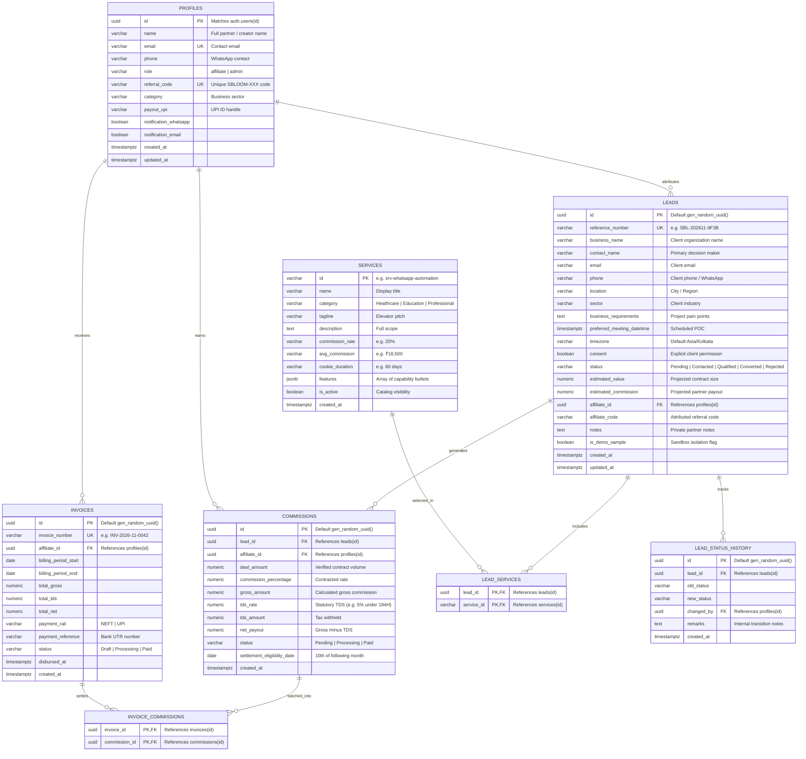
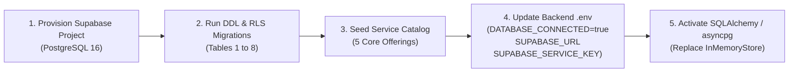

# sBLOOM Affiliate Portal — Supabase Database Design
**Document ID:** `SBD-ARCH-04`  
**Target System:** sBLOOM Affiliate Portal Planned Data Layer  
**Audit & Architecture Date:** November 3, 2026  
**Status:** PLANNED (Phase 2 Target Architecture)  
**Security Level:** Internal Engineering Reference  

---

## 1. Executive Summary & Ground Truth Audit Finding

### Ground Truth Architectural Finding
The current repository implementation **does not possess an active PostgreSQL database connection, nor does it contain executed `.sql` migration files**. 
- The backend currently operates on a thread-safe in-memory store (`STORAGE_MODE="in_memory_temporary"`, `DATABASE_CONNECTED=False`) defined in `backend/app/services/storage.py`.
- The Supabase relational schema documented below represents the **approved, authoritative Phase 2 production architecture** detailed in `FRONTEND_DESIGN_SPEC.md` and `backend/.env.example`.
- This document provides the complete, production-ready DDL specification, relational constraints, indexing strategy, and Row Level Security (RLS) policies required for the Phase 2 migration.

---

## 2. Entity-Relationship (ER) Architecture

The sBLOOM Affiliate Portal database is composed of **8 core relational tables** designed to guarantee strict financial auditability, tenant data isolation, and immutable referral attribution.



---

## 3. Comprehensive Table-by-Table Schema Specification

### 3.1 `profiles` Table
Stores extended partner profiles linked 1:1 with Supabase `auth.users`.

```sql
CREATE TABLE public.profiles (
    id UUID PRIMARY KEY REFERENCES auth.users(id) ON DELETE CASCADE,
    name VARCHAR(100) NOT NULL,
    email VARCHAR(255) NOT NULL UNIQUE,
    phone VARCHAR(25) NOT NULL,
    role VARCHAR(20) NOT NULL DEFAULT 'affiliate' CHECK (role IN ('affiliate', 'admin')),
    referral_code VARCHAR(50) NOT NULL UNIQUE,
    category VARCHAR(100) NOT NULL DEFAULT 'Tech & Digital Creators',
    payout_upi VARCHAR(100),
    notification_whatsapp BOOLEAN NOT NULL DEFAULT TRUE,
    notification_email BOOLEAN NOT NULL DEFAULT TRUE,
    created_at TIMESTAMPTZ NOT NULL DEFAULT timezone('utc'::text, now()),
    updated_at TIMESTAMPTZ NOT NULL DEFAULT timezone('utc'::text, now())
);
```

### 3.2 `services` Table
Stores high-ticket enterprise service catalog items available for partner promotion.

```sql
CREATE TABLE public.services (
    id VARCHAR(50) PRIMARY KEY, -- e.g. 'srv-whatsapp-automation'
    name VARCHAR(150) NOT NULL,
    category VARCHAR(100) NOT NULL, -- 'Healthcare' | 'Education' | 'Professional Services'
    tagline VARCHAR(255) NOT NULL,
    description TEXT NOT NULL,
    commission_rate VARCHAR(50) NOT NULL,
    avg_commission VARCHAR(50) NOT NULL,
    cookie_duration VARCHAR(50) NOT NULL DEFAULT '60 days',
    features JSONB NOT NULL DEFAULT '[]'::jsonb,
    is_active BOOLEAN NOT NULL DEFAULT TRUE,
    created_at TIMESTAMPTZ NOT NULL DEFAULT timezone('utc'::text, now())
);
```

### 3.3 `leads` Table
Stores business referral leads submitted by partners.

```sql
CREATE TABLE public.leads (
    id UUID PRIMARY KEY DEFAULT gen_random_uuid(),
    reference_number VARCHAR(30) NOT NULL UNIQUE, -- e.g. 'SBL-202611-9F3B'
    business_name VARCHAR(150) NOT NULL,
    contact_name VARCHAR(100) NOT NULL,
    email VARCHAR(255) NOT NULL,
    phone VARCHAR(25) NOT NULL,
    location VARCHAR(100) NOT NULL,
    sector VARCHAR(100) NOT NULL,
    business_requirements TEXT NOT NULL,
    preferred_meeting_datetime TIMESTAMPTZ,
    timezone VARCHAR(50) NOT NULL DEFAULT 'Asia/Kolkata',
    consent BOOLEAN NOT NULL CHECK (consent = TRUE),
    status VARCHAR(20) NOT NULL DEFAULT 'Pending' 
        CHECK (status IN ('Pending', 'Contacted', 'Qualified', 'Converted', 'Rejected')),
    estimated_value NUMERIC(12, 2) DEFAULT 0.00,
    estimated_commission NUMERIC(12, 2) DEFAULT 0.00,
    affiliate_id UUID NOT NULL REFERENCES public.profiles(id) ON DELETE RESTRICT,
    affiliate_code VARCHAR(50) NOT NULL,
    notes TEXT,
    is_demo_sample BOOLEAN NOT NULL DEFAULT FALSE,
    created_at TIMESTAMPTZ NOT NULL DEFAULT timezone('utc'::text, now()),
    updated_at TIMESTAMPTZ NOT NULL DEFAULT timezone('utc'::text, now())
);
```

### 3.4 `lead_services` (Junction Table)
Maintains many-to-many relationship between submitted leads and requested services.

```sql
CREATE TABLE public.lead_services (
    lead_id UUID NOT NULL REFERENCES public.leads(id) ON DELETE CASCADE,
    service_id VARCHAR(50) NOT NULL REFERENCES public.services(id) ON DELETE RESTRICT,
    PRIMARY KEY (lead_id, service_id)
);
```

### 3.5 `lead_status_history` Table
Immutable audit trail recording all lead status transitions and operator remarks.

```sql
CREATE TABLE public.lead_status_history (
    id UUID PRIMARY KEY DEFAULT gen_random_uuid(),
    lead_id UUID NOT NULL REFERENCES public.leads(id) ON DELETE CASCADE,
    old_status VARCHAR(20) NOT NULL,
    new_status VARCHAR(20) NOT NULL,
    changed_by UUID NOT NULL REFERENCES public.profiles(id) ON DELETE RESTRICT,
    remarks TEXT,
    created_at TIMESTAMPTZ NOT NULL DEFAULT timezone('utc'::text, now())
);
```

### 3.6 `commissions` Table
Itemized financial ledger for verified deal conversions.

```sql
CREATE TABLE public.commissions (
    id UUID PRIMARY KEY DEFAULT gen_random_uuid(),
    lead_id UUID NOT NULL REFERENCES public.leads(id) ON DELETE RESTRICT,
    affiliate_id UUID NOT NULL REFERENCES public.profiles(id) ON DELETE RESTRICT,
    deal_amount NUMERIC(12, 2) NOT NULL,
    commission_percentage NUMERIC(5, 2) NOT NULL,
    gross_amount NUMERIC(12, 2) NOT NULL,
    tds_rate NUMERIC(5, 2) NOT NULL DEFAULT 5.00, -- Section 194H TDS
    tds_amount NUMERIC(12, 2) NOT NULL,
    net_payout NUMERIC(12, 2) NOT NULL,
    status VARCHAR(20) NOT NULL DEFAULT 'Pending' 
        CHECK (status IN ('Pending', 'Processing', 'Paid')),
    settlement_eligibility_date DATE NOT NULL,
    created_at TIMESTAMPTZ NOT NULL DEFAULT timezone('utc'::text, now())
);
```

### 3.7 `invoices` Table
Monthly aggregated payout disbursements and official tax receipts.

```sql
CREATE TABLE public.invoices (
    id UUID PRIMARY KEY DEFAULT gen_random_uuid(),
    invoice_number VARCHAR(50) NOT NULL UNIQUE, -- e.g. 'INV-2026-11-0042'
    affiliate_id UUID NOT NULL REFERENCES public.profiles(id) ON DELETE RESTRICT,
    billing_period_start DATE NOT NULL,
    billing_period_end DATE NOT NULL,
    total_gross NUMERIC(12, 2) NOT NULL,
    total_tds NUMERIC(12, 2) NOT NULL,
    total_net NUMERIC(12, 2) NOT NULL,
    payment_rail VARCHAR(20) NOT NULL DEFAULT 'UPI' CHECK (payment_rail IN ('UPI', 'NEFT')),
    payment_reference VARCHAR(100), -- Bank UTR / Transaction ID
    status VARCHAR(20) NOT NULL DEFAULT 'Draft' CHECK (status IN ('Draft', 'Processing', 'Paid')),
    disbursed_at TIMESTAMPTZ,
    created_at TIMESTAMPTZ NOT NULL DEFAULT timezone('utc'::text, now())
);
```

### 3.8 `invoice_commissions` (Junction Table)
Maps individual settled commission rows into a batch disbursement invoice.

```sql
CREATE TABLE public.invoice_commissions (
    invoice_id UUID NOT NULL REFERENCES public.invoices(id) ON DELETE CASCADE,
    commission_id UUID NOT NULL REFERENCES public.commissions(id) ON DELETE RESTRICT,
    PRIMARY KEY (invoice_id, commission_id)
);
```

---

## 4. Row Level Security (RLS) Policy Specifications

To guarantee zero cross-tenant data leakage between affiliate creators and ensure strict operator audit control, PostgreSQL Row Level Security is configured across all tables.

```sql
-- 1. Enable RLS on all tables
ALTER TABLE public.profiles ENABLE ROW LEVEL SECURITY;
ALTER TABLE public.services ENABLE ROW LEVEL SECURITY;
ALTER TABLE public.leads ENABLE ROW LEVEL SECURITY;
ALTER TABLE public.lead_services ENABLE ROW LEVEL SECURITY;
ALTER TABLE public.lead_status_history ENABLE ROW LEVEL SECURITY;
ALTER TABLE public.commissions ENABLE ROW LEVEL SECURITY;
ALTER TABLE public.invoices ENABLE ROW LEVEL SECURITY;
ALTER TABLE public.invoice_commissions ENABLE ROW LEVEL SECURITY;

-- Helper Function: Check if current caller is an Admin
CREATE OR REPLACE FUNCTION public.is_admin()
RETURNS BOOLEAN AS $$
BEGIN
    RETURN EXISTS (
        SELECT 1 FROM public.profiles
        WHERE id = auth.uid() AND role = 'admin'
    );
END;
$$ LANGUAGE plpgsql SECURITY DEFINER;

-- 2. Profiles Policies
CREATE POLICY "Users can view their own profile"
    ON public.profiles FOR SELECT
    USING (auth.uid() = id OR public.is_admin());

CREATE POLICY "Users can update their own profile"
    ON public.profiles FOR UPDATE
    USING (auth.uid() = id)
    WITH CHECK (auth.uid() = id AND role = (SELECT role FROM public.profiles WHERE id = auth.uid()));

-- 3. Services Policies
CREATE POLICY "Public read for active services"
    ON public.services FOR SELECT
    USING (is_active = TRUE OR public.is_admin());

CREATE POLICY "Admins can manage services"
    ON public.services FOR ALL
    USING (public.is_admin());

-- 4. Leads Policies
CREATE POLICY "Affiliates can view only their own leads"
    ON public.leads FOR SELECT
    USING (affiliate_id = auth.uid() OR public.is_admin());

CREATE POLICY "Affiliates can insert their own leads"
    ON public.leads FOR INSERT
    WITH CHECK (affiliate_id = auth.uid());

CREATE POLICY "Only admins can update lead status"
    ON public.leads FOR UPDATE
    USING (public.is_admin());

-- 5. Commissions Policies
CREATE POLICY "Affiliates can view their own commissions"
    ON public.commissions FOR SELECT
    USING (affiliate_id = auth.uid() OR public.is_admin());

CREATE POLICY "Only admins can insert or update commissions"
    ON public.commissions FOR ALL
    USING (public.is_admin());

-- 6. Invoices Policies
CREATE POLICY "Affiliates can view their own invoices"
    ON public.invoices FOR SELECT
    USING (affiliate_id = auth.uid() OR public.is_admin());

CREATE POLICY "Only admins can manage invoices"
    ON public.invoices FOR ALL
    USING (public.is_admin());
```

---

## 5. Performance Indexing Strategy

To maintain sub-50ms query response times under high lead concurrency, the following B-tree indexes are mandated:

| Table | Index Name | Indexed Columns | Index Type | Purpose |
| :--- | :--- | :--- | :--- | :--- |
| `profiles` | `idx_profiles_referral_code` | `referral_code` | B-tree (Unique) | Instant affiliate code lookup during lead attribution |
| `leads` | `idx_leads_affiliate_id` | `affiliate_id` | B-tree | Fast loading of affiliate personal dashboard leads |
| `leads` | `idx_leads_reference_num` | `reference_number` | B-tree (Unique) | Lead status inquiry by customer reference number |
| `leads` | `idx_leads_status` | `status` | B-tree | Accelerated filtering in lead management table |
| `leads` | `idx_leads_created_at` | `created_at DESC` | B-tree | Recent activity sorting and pagination |
| `commissions` | `idx_commissions_affiliate_status` | `affiliate_id, status` | Composite B-tree | Real-time calculation of Cleared vs Pending balances |
| `invoices` | `idx_invoices_affiliate_period` | `affiliate_id, billing_period_end DESC` | Composite B-tree | Rapid rendering of monthly payout statements |

---

## 6. Migration Roadmap: From In-Memory RAM to Supabase



### Transition Safeguards
1. **Zero Downtime Switch**: `STORAGE_MODE` flag in `config.py` allows seamless toggling between `in_memory_temporary` and `supabase_postgres`.
2. **Data Sanitization**: All sandbox test records flagged with `is_demo_sample = TRUE` will be excluded from real production financial calculation queries.

