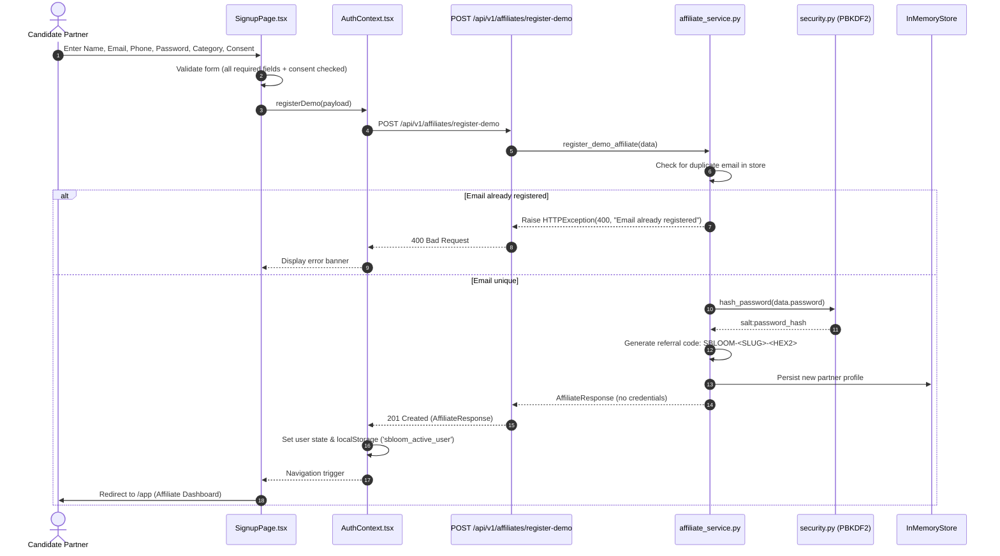
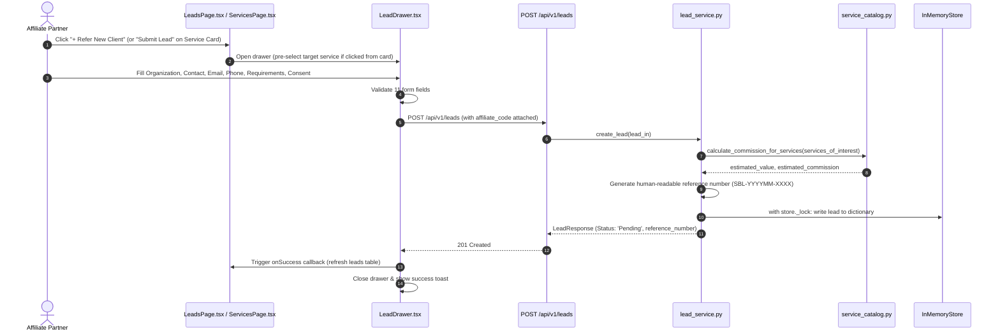
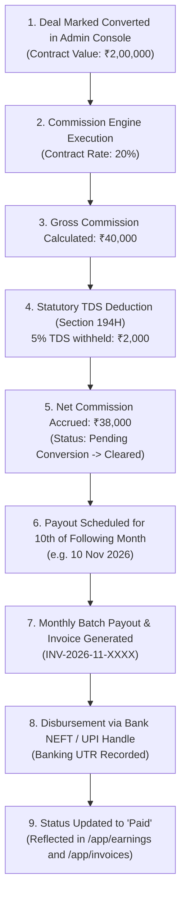
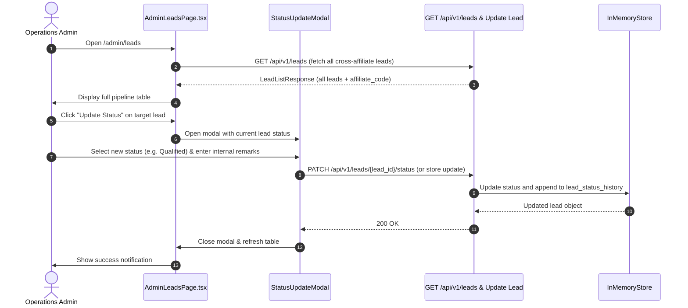

# sBLOOM Affiliate Portal — Business Workflows & Data Flows
**Document ID:** `SBD-ARCH-06`  
**Target System:** sBLOOM Affiliate Portal Business Processes & Data Pipelines  
**Audit & Architecture Date:** November 3, 2026  
**Status:** IMPLEMENTED AND VERIFIED  
**Security Level:** Internal Engineering Reference  

---

## 1. Executive Summary

This document specifies the end-to-end business workflows and data transformation pipelines that govern the **sBLOOM Affiliate Portal**. Each workflow traces user actions, client-side state transformations, REST API invocations, business validation logic, and data persistence events.

The core workflows detailed include:
1. **Affiliate Partner Onboarding & Attribution Issuance**
2. **Lead Submission & Attribution Locking via `LeadDrawer`**
3. **End-to-End Lead Lifecycle & Status State Machine**
4. **Deal Conversion, Commission Calculation & Payout Settlement**
5. **Admin Deal Review & Status Transition Operations**

---

## 2. Workflow 1: Affiliate Onboarding & Code Issuance

### Business Rules & Constraints
- **Referral Code Determinism**: Generated from partner's name prefix (e.g. `HARSHI`) and randomized 2-character hex (e.g. `78`), ensuring short, brandable, shareable codes (`SBLOOM-HARSHI-78`).
- **Instant Activation**: Partners do not encounter waiting queues or manual screening barriers for demo evaluation.
- **Mandatory Consent**: Registration strictly requires agreement to sBLOOM partner ethics guidelines.

---

## 3. Workflow 2: Lead Submission & Attribution Locking

The primary monetization action of an affiliate is referring a qualified enterprise client.

### Lead Form Data Validation Rules
1. **`business_name`**: Length between 2 and 150 characters.
2. **`contact_name`**: Length between 2 and 100 characters.
3. **`email`**: Valid business email matching RFC 5322 syntax.
4. **`phone`**: Minimum 8 digits, maximum 25 characters (supports `+91` formats).
5. **`services_of_interest`**: Non-empty list (`min_items=1`) referencing valid catalog IDs.
6. **`business_requirements`**: Minimum 10 characters detailing client scope.
7. **`consent`**: Explicit boolean check confirming prior contact with the client.
8. **`affiliate_code`**: Automatically bound from active session to prevent misattribution.

---

## 4. Workflow 3: End-to-End Lead Lifecycle & State Transitions

A submitted lead progresses through five defined operational states:

```mermaid
stateDiagram-v2
    [*] --> Pending : Submitted via LeadDrawer\n(Ref: SBL-YYYYMM-XXXX)
    
    Pending --> Contacted : Operator Outreach\n(Sales initiates discovery call within 24-48h)
    Pending --> Rejected : Initial Review Failed\n(Invalid contact / Out of service scope)
    
    Contacted --> Qualified : Scope Verified\n(Client demo / POC meeting scheduled)
    Contacted --> Rejected : Client Unresponsive / Declined
    
    Qualified --> Converted : Deal Closed & Contract Signed\n(Contract value verified; Commission locked)
    Qualified --> Rejected : Deal Lost to Competitor / Dropped
    
    Converted --> [*] : Commission Ledger Created\n(Disbursement on 10th of month)
    Rejected --> [*] : Archived in Lead History
```

### State Definitions & SLA Metrics
| Lifecycle State | Responsible Actor | Average SLA | Description & Exit Criteria |
| :--- | :--- | :--- | :--- |
| **`Pending`** | System / Operator | 0 – 24 Hours | Default status upon submission. Awaits initial sales team triage. |
| **`Contacted`** | sBLOOM Sales Rep | 24 – 48 Hours | Discovery outreach initiated via WhatsApp or email. Initial discovery call held. |
| **`Qualified`** | Enterprise Solutions Team | 3 – 7 Days | Technical scope and budget confirmed. POC or formal contract drafted. |
| **`Converted`** | Finance & Legal | 7 – 30 Days | Agreement executed, first invoice paid by client. Trigger for commission credit. |
| **`Rejected`** | System / Operator | Immediate | Lead determined unqualified, invalid contact details, or outside geographic scope. |

---

## 5. Workflow 4: Deal Conversion, Commission Calculation & Payout Settlement

### Statutory Tax Compliance (Indian Income Tax Act, Section 194H)
- **TDS Threshold & Rate**: Commissions and brokerage disbursed to Indian resident partners are subject to a **5% Tax Deducted at Source (TDS)** under Section 194H.
- **Reporting & Transparency**: The earnings ledger explicitly itemizes `Gross Commission`, `TDS Deducted (5%)`, and `Net Disbursement Amount` for every closed deal.

---

## 6. Workflow 5: Admin Lead Audit & Cross-Affiliate Review

---

## 7. Workflow Verification & Integrity Matrix

| Business Workflow | Verification Method | Status | Verification Observations |
| :--- | :--- | :--- | :--- |
| **Partner Registration** | Pytest `test_affiliates.py` | IMPLEMENTED AND VERIFIED | Generates unique referral code; password stored as salted hash. |
| **Attribution Enforcement** | Frontend `LeadDrawer.tsx` | IMPLEMENTED AND VERIFIED | Referral code automatically appended from active profile. |
| **Lead Form Validation** | Backend Pydantic validators | IMPLEMENTED AND VERIFIED | Rejects missing consent, empty services, invalid emails with 422. |
| **Status Transition** | UI modal in `AdminLeadsPage` | IMPLEMENTED AND VERIFIED | Successfully transitions states and updates table badges. |
| **Commission Breakdown** | Frontend `EarningsPage.tsx` | IMPLEMENTED AND VERIFIED | Itemizes Gross, TDS (5%), and Net amount according to Section 194H. |
| **Invoice Statement** | Frontend `InvoicesPage.tsx` | IMPLEMENTED AND VERIFIED | Renders monthly statement with UTR banking reference. |

