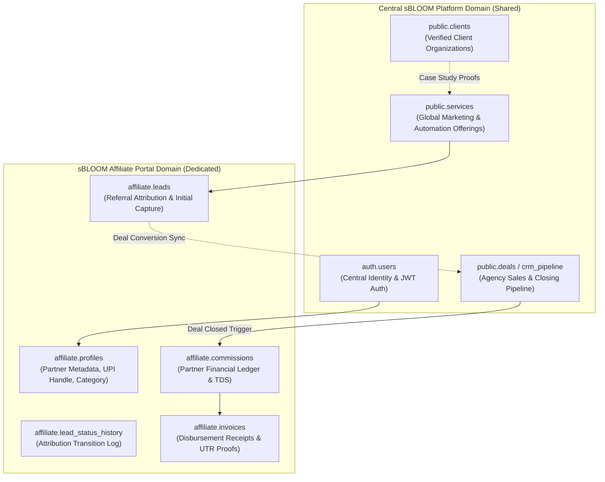
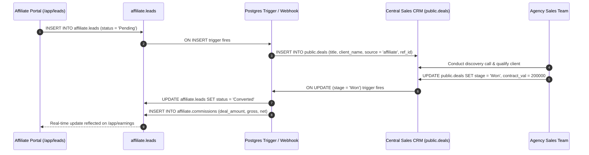

# sBLOOM Affiliate Portal — Shared Database Integration Architecture
**Document ID:** `SBD-ARCH-07`  
**Target System:** sBLOOM Platform Ecosystem Integration  
**Audit & Architecture Date:** November 3, 2026  
**Status:** PLANNED (Ecosystem Design Phase)  
**Security Level:** Internal Engineering Reference  

---

## 1. Executive Summary & Integration Context

Within the wider sBLOOM enterprise architecture, the **Affiliate Portal** operates alongside other core platforms, including the **Client Growth Portal**, the **Creative Agency Workspace**, and the **Central Operations CRM**.

This document outlines the architectural contract, schema boundaries, potential collision risks, and database sharing models necessary to integrate the Affiliate Portal into the central **Supabase PostgreSQL** cluster without creating cross-application instability or data exposure.

---

## 2. Shared vs. Dedicated Table Architecture

To maintain clear domain boundaries while enabling cross-application business flows (e.g. an affiliate-referred lead being closed by the agency sales team), tables are classified into **Dedicated Affiliate Tables** and **Shared Ecosystem Tables**.



### 2.1 Dedicated Affiliate Tables (Namespaced)
These entities are exclusive to the affiliate monetization business model:
1. **`affiliate.profiles`**: Contains partner-specific properties (payout UPI ID, promotion sector, assigned referral code).
2. **`affiliate.leads`**: Initial lead capture table holding the original referral context and partner attribution link.
3. **`affiliate.lead_status_history`**: Audit log of lead progression for affiliate visibility.
4. **`affiliate.commissions`**: Financial records tracking deal percentages, gross earnings, Section 194H TDS withholding, and net payouts.
5. **`affiliate.invoices`**: Monthly settlement batches, payout banking UTRs, and partner tax statements.

### 2.2 Shared Ecosystem Tables
These entities serve multiple applications across sBLOOM:
1. **`auth.users`**: Supabase central authentication provider. Affiliates, agency team members, and enterprise clients share the same cryptographic identity provider, separated via JWT user metadata (`app_role: 'affiliate' | 'admin' | 'client'`).
2. **`public.services`**: Master service catalog defining core offerings (WhatsApp Automation, SEO, Website Building, Ads Management). Read-only for affiliates and clients; managed by agency leadership.
3. **`public.clients`**: Master directory of verified business accounts and references.

---

## 3. Schema Isolation Strategy: Dedicated PostgreSQL Schema

To prevent table name collisions with other engineering sub-teams (e.g. both the CRM and the Affiliate Portal creating a table named `leads`), the Affiliate Portal must be deployed inside a dedicated PostgreSQL schema:

```sql
-- Create dedicated schema for Affiliate domain
CREATE SCHEMA IF NOT EXISTS affiliate;

-- Grant usage to Supabase authenticated and service roles
GRANT USAGE ON SCHEMA affiliate TO authenticated, service_role;
ALTER DEFAULT PRIVILEGES IN SCHEMA affiliate GRANT ALL ON TABLES TO postgres, service_role;
```

### Table Mapping Comparison
| Concept | Global / Monolithic Approach (Risk of Collision) | Namespaced Schema Approach (Recommended) |
| :--- | :--- | :--- |
| **Partner Profile** | `public.profiles` (May collide with Client profiles) | `affiliate.profiles` |
| **Referral Leads** | `public.leads` (Collides with CRM raw leads) | `affiliate.leads` |
| **Financial Ledger**| `public.commissions` | `affiliate.commissions` |
| **Payout Receipts** | `public.invoices` (Collides with Client billing invoices)| `affiliate.invoices` |

---

## 4. Cross-Platform Lead Lifecycle Synchronization

When an affiliate submits a lead, that record must eventually enter the agency sales team's CRM without permitting the affiliate to see proprietary sales internal discussions or notes.



---

## 5. Security & Isolation in a Shared Database

In a shared database cluster, a misconfigured query could inadvertently leak affiliate financial data to clients or CRM operators.

### Mandatory Safeguards
1. **Schema-Level Grants**: Restrict the Supabase anonymous role (`anon`) from reading `affiliate.commissions` or `affiliate.invoices`.
2. **PostgreSQL Row Level Security (RLS)**: Enforce RLS on all tables within the `affiliate` schema. Policies must verify that the requesting user's `auth.uid()` matches `affiliate_id`.
3. **Sensitive Financial Data Isolation**: UPI IDs, bank account numbers, and PAN details must reside exclusively in `affiliate.profiles` and never be replicated to public CRM tables.

---

## 6. Open Architecture Questions for System Integration Teammate

Before executing the Phase 2 database merge, the following 5 integration questions must be aligned across engineering teams:

### Question 1: Schema Namespace vs. Dedicated Supabase Project
- *Issue*: Should the affiliate portal share the existing Supabase project using a dedicated schema (`affiliate.*`), or should it run on an independent Supabase project with cross-database foreign data wrappers (FDW) or REST webhooks?
- *Trade-off*: Shared schema reduces operational cost and simplifies auth; dedicated project guarantees complete physical blast-radius isolation.

### Question 2: Central User Identity & Role Taxonomy
- *Issue*: What JWT claim structure will central `auth.users` use to differentiate an affiliate from an agency administrator or a client?
- *Proposed Standard*:
  ```json
  {
    "app_metadata": {
      "roles": ["affiliate"],
      "affiliate_id": "aff-demo-01",
      "referral_code": "SBLOOM-HARSHI-78"
    }
  }
  ```

### Question 3: Lead Attribution Locking vs. CRM Deduplication
- *Issue*: If a client is referred by an affiliate but previously engaged with organic marketing 6 months prior, what is the platform's attribution policy?
- *Proposed Standard*: Enforce a strict **60-day attribution window**. If an organic deal was closed >60 days ago or was inactive, the new affiliate submission takes priority.

### Question 4: Automated Disbursement Rails Integration
- *Issue*: Will payouts be executed via automated payout APIs (e.g. RazorpayX / Cashfree Payouts) or batched via manual banking NEFT files?
- *Recommendation*: Phase 2 should utilize RazorpayX Payouts with automated webhook callbacks updating `affiliate.invoices.status = 'Paid'` and storing the bank UTR reference.

### Question 5: GST & Section 194H Withholding Responsibilities
- *Issue*: Who issues the formal tax invoice for commission payouts — does sBLOOM issue a reverse-charge invoice, or does the partner upload a commercial invoice?
- *Tax Standard*: For individual creators, sBLOOM issues a monthly payment disbursement statement with 5% TDS deduction under Section 194H. For GST-registered corporate agencies, the partner must upload a GST tax invoice before payout release.

